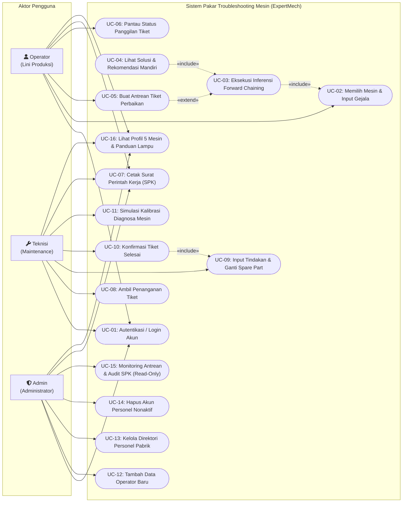
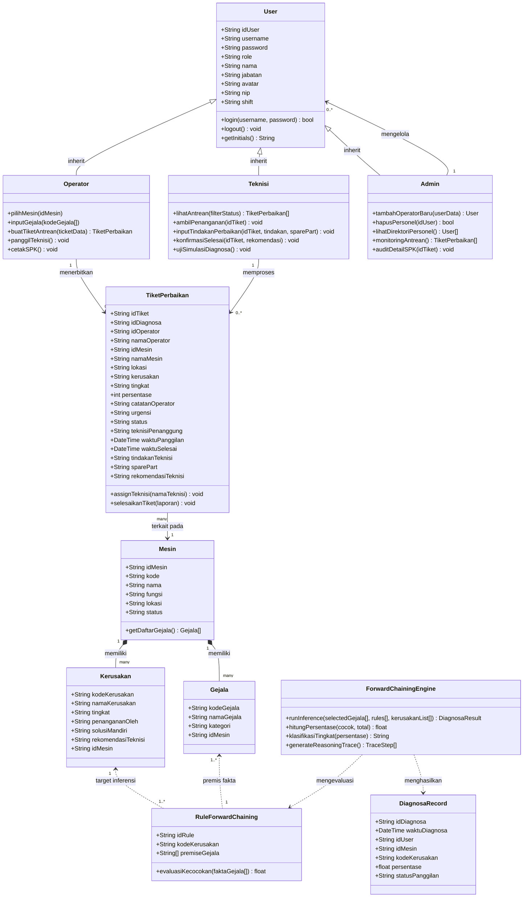
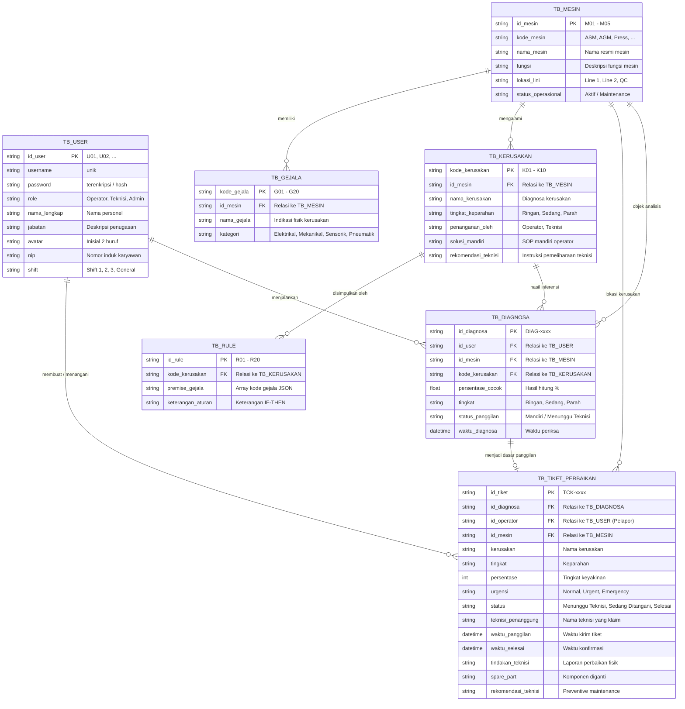

# Dokumentasi Sistem Pakar Troubleshooting Mesin Produksi
**Studi Kasus: PT Vivo Mobile Indonesia | Metode: Forward Chaining**

Dokumen ini menyajikan pemodelan arsitektur perangkat lunak lengkap sistem pakar, yang mencakup:
1. **Use Case Diagram** beserta spesifikasi wewenang **3 Aktor** (*Operator*, *Teknisi*, dan *Admin*).
2. **Class Diagram** berorientasi objek yang memetakan komponen antarmuka, logika inferensi (*Forward Chaining Engine*), entitas data, dan kontrol tiket.
3. **Entity Relationship Diagram (ERD) & Struktur Tabel Database (3NF)**.
4. **Isi Data Riil Database** (*Data Dictionary & Live Records*) yang digunakan dalam sistem aplikasi.

---

## 1. Use Case Diagram (3 Aktor)

Sistem membedakan tanggung jawab pengguna secara tegas menjadi 3 aktor lini manufaktur:
* **Operator**: Mendiagnosa gangguan awal dan **membuat antrean tiket perbaikan**.
* **Teknisi**: **Memproses dan menyelesaikan antrean perbaikan** di lantai produksi.
* **Admin**: **Manajemen operator/personel baru** dan pengawasan sistem (*read-only monitoring*).

### Tabel Spesifikasi Use Case Per Aktor

| No | Kode UC | Nama Use Case | Aktor Utama | Deskripsi Wewenang |
|---|---|---|---|---|
| 1 | `UC-01` | Autentikasi / Login | Operator, Teknisi, Admin | Memvalidasi identitas pengguna menggunakan Username dan Kata Sandi terdaftar. |
| 2 | `UC-02` | Memilih Mesin & Input Gejala | Operator, Teknisi | Memilih stasiun mesin (ASM, AGM, Press, AirTightness, Coldpress) dan menandai indikasi gejala fisik lapangan. |
| 3 | `UC-03` | Eksekusi Inferensi Forward Chaining | Operator, Teknisi | Mesin inferensi mencocokkan fakta gejala terhadap basis aturan IF-THEN dan menghitung persentase kecocokan. |
| 4 | `UC-04` | Lihat Solusi & Rekomendasi Mandiri | Operator | Menampilkan instruksi penanganan mandiri jika indikator Kuning / kerusakan Ringan (<50%). |
| 5 | `UC-05` | Buat Antrean Tiket Perbaikan | **Operator** | **Menerbitkan tiket perbaikan baru** (`Menunggu Teknisi`) baik via rekomendasi diagnosa maupun tombol manual di antrean. |
| 6 | `UC-06` | Pantau Status Panggilan Tiket | Operator | Memantau apakah teknisi sudah mengambil penanganan atau pekerjaan telah selesai. |
| 7 | `UC-07` | Cetak Surat Perintah Kerja (SPK) | Semua Aktor | Mencetak lembar kerja resmi standar PT Vivo Mobile Indonesia untuk dokumentasi fisik. |
| 8 | `UC-08` | Ambil Penanganan Tiket | **Teknisi** | **Mengklaim tiket antrean** dan mengubah status menjadi `Sedang Ditangani`. |
| 9 | `UC-09` | Input Tindakan & Ganti Spare Part | **Teknisi** | Mendokumentasikan langkah perbaikan teknis dan komponen mekanik/elektrik yang diganti. |
| 10 | `UC-10` | Konfirmasi Tiket Selesai | **Teknisi** | Mengubah status tiket menjadi `Selesai` dan merekam catatan preventif untuk operator. |
| 11 | `UC-11` | Simulasi Kalibrasi Diagnosa | Teknisi | Menguji skenario kerusakan (Kasus 1-8) untuk verifikasi akurasi sensor dan logika aturan. |
| 12 | `UC-12` | Tambah Data Operator Baru | **Admin** | **Mendaftarkan akun operator/teknisi baru** (Nama, NIP, Stasiun Mesin, Shift, Username, Password). |
| 13 | `UC-13` | Kelola Direktori Personel Pabrik | **Admin** | Melihat seluruh daftar akun, mengaudit stasiun lini, dan menyalin kredensial login. |
| 14 | `UC-14` | Hapus Akun Personel Nonaktif | **Admin** | Menghapus akun yang sudah mutasi atau tidak aktif (proteksi akun admin aktif). |
| 15 | `UC-15` | Monitoring Antrean & Audit SPK | **Admin** | Memantau seluruh tiket masuk secara *Read-Only* tanpa memanipulasi progres teknisi. |
| 16 | `UC-16` | Lihat Profil 5 Mesin Pabrik | Semua Aktor | Membuka katalog teknis mesin dan SOP penanganan indikator lampu kuning vs merah. |

---

## 2. Class Diagram

Class diagram menggambarkan arsitektur berbasis objek (OOP) dari sistem web, mencakup entitas data (*Entities*), mesin penalar inferensi (*Controller/Engine*), dan komponen antarmuka antrean (*Boundary*).

---

## 3. Entity Relationship Diagram (ERD) - Skema 3NF

Desain database telah ternormalisasi hingga **Bentuk Normal Ketiga (Third Normal Form / 3NF)** untuk menghilangkan redundansi data dan mencegah anomali *insert/update/delete*.

---

## 4. Struktur & Isi Data Riil Database

Berikut adalah tabel-tabel database beserta **data riil yang tersimpan dan aktif digunakan di dalam sistem**:

### Tabel 1: `tb_user` (Data Personel & Kredensial 3 Aktor)

| id_user | username | password | role | nama_lengkap | jabatan | nip | shift |
|---|---|---|---|---|---|---|---|
| `U01` | `Operator` | `Operator1` | `Operator` | Budi Santoso | Operator Lini Assembly (ASM) | `EMP-VVO-2024-081` | Shift 1 (Pagi) |
| `U02` | `Teknisi` | `Teknisi1` | `Teknisi` | Rian Kurniawan | Lead Maintenance & Automation | `ENG-VVO-2021-019` | General Maintenance |
| `U03` | `operator.dispensing` | `Dispensing2026` | `Operator` | Dimas Pratama | Operator Lini Dispensing Lem (AGM) | `EMP-VVO-2025-112` | Shift 1 (Pagi) |
| `U04` | `operator.qc` | `Airtight2026` | `Operator` | Siti Nurhaliza | QC & AirTightness Tester | `QC-VVO-2024-044` | Shift 2 (Siang) |
| `U05` | `Admin` | `Admin1` | `Admin` | Hendra Wijaya | System Administrator & Plant Lead | `ADM-VVO-2019-001` | General / All Shifts |

---

### Tabel 2: `tb_mesin` (Katalog 5 Mesin Manufaktur PT Vivo)

| id_mesin | kode_mesin | nama_mesin | fungsi | lokasi_lini | status |
|---|---|---|---|---|---|
| `M01` | `ASM` | Mesin ASM (Automatic Screw Manual) | Pemasangan baut otomatis pada casing smartphone | Line Assembly 1 - PT Vivo | Aktif |
| `M02` | `AGM` | Mesin AGM (Automatic Glue Manual) | Pengolesan lem perekat bodi dan layar smartphone | Line Dispensing 2 - PT Vivo | Aktif |
| `M03` | `PRESS3IN1` | Mesin Press 3 in 1 | Penekanan simultan 4 sisi bodi smartphone | Line Assembly 3 - PT Vivo | Aktif |
| `M04` | `AIRTIGHT` | Mesin AirTightness | Uji kedap air dan tekanan kedap udara (Waterproof) | Stasiun QC Testing - PT Vivo | Aktif |
| `M05` | `COLDPRESS` | Mesin Control Coldpress Pressure | Pengepresan dingin modul baterai smartphone | Line Battery Assembly - PT Vivo | Aktif |

---

### Tabel 3: `tb_gejala` (Koleksi Indikasi Gejala G01 - G20)

| kode_gejala | id_mesin | nama_gejala | kategori |
|---|---|---|---|
| `G01` | `M01` | Mesin mati total tidak merespons tombol power | Elektrikal |
| `G02` | `M01` | Lampu indikator power padam total | Elektrikal |
| `G03` | `M02` | Conveyor (kompayer) macet tidak berputar | Mekanikal |
| `G04` | `M02` | Motor penggerak panas berlebih (overheat) | Termal |
| `G05` | `M03` | Sensor posisi tidak membaca modul produk | Sensorik |
| `G06` | `M03` | Alarm buzzer penekanan berbunyi kontinu | Sensorik |
| `G07` | `M04` | Suara desisan angin bocor di area silinder | Pneumatik |
| `G08` | `M04` | Jarum penunjuk tekanan udara berfluktuasi | Pneumatik |
| `G09` | `M01` | Mesin berhenti mendadak saat siklus kerja | Mekanikal |
| `G10` | `M01` | Suhu modul controller di atas ambang normal | Termal |
| `G11` | `M01` | Baut tidak keluar dari rel peluncur feeder | Mekanikal |
| `G12` | `M01` | Silicone pada smartphone terangkat / miring | Mekanikal |
| `G13` | `M01` | Lampu indikator kuning menyala (Status NG) | Sensorik |
| `G14` | `M02` | Lem meluber atau posisi lem melenceng | Mekanikal |
| `G15` | `M02` | Peringatan lem beku pada nosel dispenser | Termal |
| `G16` | `M03` | Tekanan silinder pres melebihi batas 418 | Pneumatik |
| `G17` | `M04` | Status pengujian selalu NG (Not Good) | Sensorik |
| `G18` | `M05` | Kamera barcode gagal mendeteksi kode baterai | Sensorik |
| `G19` | `M05` | Silinder penekan dingin tidak mau turun | Mekanikal |
| `G20` | `M05` | Alarm berkala aktif setiap interval 4 jam | Sensorik |

---

### Tabel 4: `tb_kerusakan` (Daftar Kerusakan & Solusi K01 - K10)

| kode_kerusakan | id_mesin | nama_kerusakan | tingkat | penanganan_oleh | solusi_mandiri / teknisi |
|---|---|---|---|---|---|
| `K01` | `M01` | Kerusakan Modul Power Supply Utama | `Parah` | `Teknisi` | Periksa kabel input AC 220V dan ganti sekring/modul power supply unit. |
| `K02` | `M02` | Kemacetan Mekanikal & Motor Conveyor | `Parah` | `Teknisi` | Matikan power, bersihkan rel conveyor, beri pelumas, cek kapasitor motor. |
| `K03` | `M03` | Malafungsi Sensor Posisi Press 3 in 1 | `Sedang` | `Teknisi` | Bersihkan lensa optik sensor dari debu perekat dan kalibrasi limit switch. |
| `K04` | `M04` | Kebocoran Sistem Pneumatik AirTightness | `Parah` | `Teknisi` | Ganti selang pneumatik yang getas dan kencangkan seal fitting coupler. |
| `K05` | `M01` | Gangguan Overheating Modul ASM | `Sedang` | `Teknisi` | Periksa kipas pendingin modul dan tambahkan pasta termal pendingin. |
| `K06` | `M01` | Feeder Baut Tersumbat & Silicone Miring | `Ringan` | `Operator` | **Tindakan Mandiri Operator**: Ketuk perlahan rel peluncur baut dan rapikan kembali silicone smartphone. |
| `K07` | `M02` | Nosel Dispenser Lem Meluber / Mampet | `Sedang` | `Operator` | Bersihkan nosel lem menggunakan pelarut pembersih dan lakukan purging. |
| `K08` | `M03` | Overpressure Silinder Press 3 in 1 | `Parah` | `Teknisi` | Setel ulang regulator pneumatik agar tekanan kerja tidak melebihi 418 kPa. |
| `K09` | `M04` | Kegagalan Uji Kedap Udara (AirTight) | `Sedang` | `Teknisi` | Uji kalibrasi ruang vakum chamber dan ganti karet gasket pengunci. |
| `K10` | `M05` | Sensor Barcode Error & Silinder Macet | `Parah` | `Teknisi` | Bersihkan kamera pembaca barcode baterai dan lumasi poros silinder hidrolik. |

---

### Tabel 5: `tb_rule` (Aturan Inferensi Forward Chaining R01 - R20)

| id_rule | kode_kerusakan | premise_gejala (IF) | keterangan_aturan |
|---|---|---|---|
| `R01` | `K01` | `["G01", "G02"]` | JIKA mesin mati total DAN indikator padam MAKA Power Supply Rusak |
| `R02` | `K01` | `["G01"]` | JIKA mesin mati total MAKA indikasi awal Power Supply Rusak |
| `R03` | `K02` | `["G03", "G04"]` | JIKA conveyor macet DAN motor overheat MAKA Motor Conveyor Jammed |
| `R04` | `K02` | `["G03"]` | JIKA conveyor macet MAKA periksa jalur mekanik conveyor |
| `R05` | `K03` | `["G05", "G06"]` | JIKA sensor posisi gagal DAN alarm bunyi MAKA Sensor Error |
| `R06` | `K03` | `["G05"]` | JIKA sensor posisi gagal MAKA bersihkan sensor posisi |
| `R07` | `K04` | `["G07", "G08"]` | JIKA ada desisan angin DAN tekanan fluktuasi MAKA Kebocoran Pneumatik |
| `R08` | `K04` | `["G07"]` | JIKA ada desisan angin MAKA periksa sambungan fitting selang |
| `R09` | `K05` | `["G09", "G10"]` | JIKA mesin stop mendadak DAN modul panas MAKA Modul Overheating |
| `R10` | `K05` | `["G10"]` | JIKA modul panas MAKA periksa sistem sirkulasi kipas pendingin |
| `R11` | `K06` | `["G11", "G12"]` | JIKA baut macet di rel DAN silicone miring MAKA Kasus Ringan ASM |
| `R12` | `K06` | `["G13"]` | JIKA indikator kuning menyala MAKA Tangani Mandiri Operator |
| `R13` | `K07` | `["G14", "G15"]` | JIKA lem meluber DAN nosel lem beku MAKA Nosel Lem Dispenser Rusak |
| `R14` | `K07` | `["G14"]` | JIKA lem meluber melenceng MAKA Bersihkan ujung jarum nosel |
| `R15` | `K08` | `["G16", "G06"]` | JIKA tekanan > 418 DAN buzzer aktif MAKA Overpressure Silinder Press |
| `R16` | `K08` | `["G16"]` | JIKA tekanan silinder > 418 MAKA Bahaya overpressure bodi |
| `R17` | `K09` | `["G17", "G08"]` | JIKA hasil uji selalu NG DAN tekanan goyang MAKA Kebocoran Chamber |
| `R18` | `K09` | `["G17"]` | JIKA uji waterproof selalu NG MAKA Kalibrasi ulang ruang vakum |
| `R19` | `K10` | `["G18", "G19", "G20"]` | JIKA kamera barcode error DAN silinder macet MAKA Coldpress Error |
| `R20` | `K10` | `["G18", "G19"]` | JIKA kamera error DAN silinder tertahan MAKA Periksa sensor dan pneumatik |

---

### Tabel 6: `tb_tiket_perbaikan` (Antrean Tiket Perbaikan Aktif di Sistem)

| id_tiket | id_operator | id_mesin | kerusakan | urgensi | status | teknisi_penanggung | waktu_panggilan | tindakan_teknisi |
|---|---|---|---|---|---|---|---|---|
| `TCK-1001` | `U01` (Budi) | `M01` (ASM) | Kerusakan Modul Power Supply | `Emergency` | `Menunggu Teknisi` | `-` | 16/11/2026, 08:30 | `- (Dalam antrean)` |
| `TCK-1002` | `U03` (Dimas) | `M02` (AGM) | Kemacetan Mekanikal Conveyor | `Urgent` | `Sedang Ditangani` | Rian Kurniawan | 16/11/2026, 09:15 | Pembersihan rel conveyor & kalibrasi belt |
| `TCK-1003` | `U04` (Siti) | `M04` (AirTight) | Kebocoran Sistem Pneumatik | `Normal` | `Selesai` | Rian Kurniawan | 15/11/2026, 14:00 | Penggantian selang pneumatik 6mm & seal ring |

---

## 5. Ringkasan Keterkaitan Antara 3 Aktor dengan Database

1. **Operator**:
   * Membaca `tb_mesin` dan `tb_gejala`.
   * Menjalankan kueri pencocokan ke `tb_rule` dan `tb_kerusakan` via *Forward Chaining Engine*.
   * Menulis rekaman baru (*INSERT*) ke `tb_diagnosa` dan `tb_tiket_perbaikan` dengan status awal `Menunggu Teknisi`.
2. **Teknisi**:
   * Membaca antrean `tb_tiket_perbaikan` dengan status `Menunggu Teknisi`.
   * Melakukan pembaruan data (*UPDATE*) pada kolom `status`, `teknisi_penanggung`, `tindakan_teknisi`, `spare_part`, dan `waktu_selesai`.
3. **Admin**:
   * Melakukan manipulasi akun (*INSERT*, *UPDATE*, *DELETE*) pada tabel `tb_user`.
   * Membaca seluruh data (*SELECT*) pada `tb_tiket_perbaikan` dan `tb_diagnosa` untuk keperluan audit dan monitoring operasional tanpa izin merubah data tiket perbaikan teknisi.
